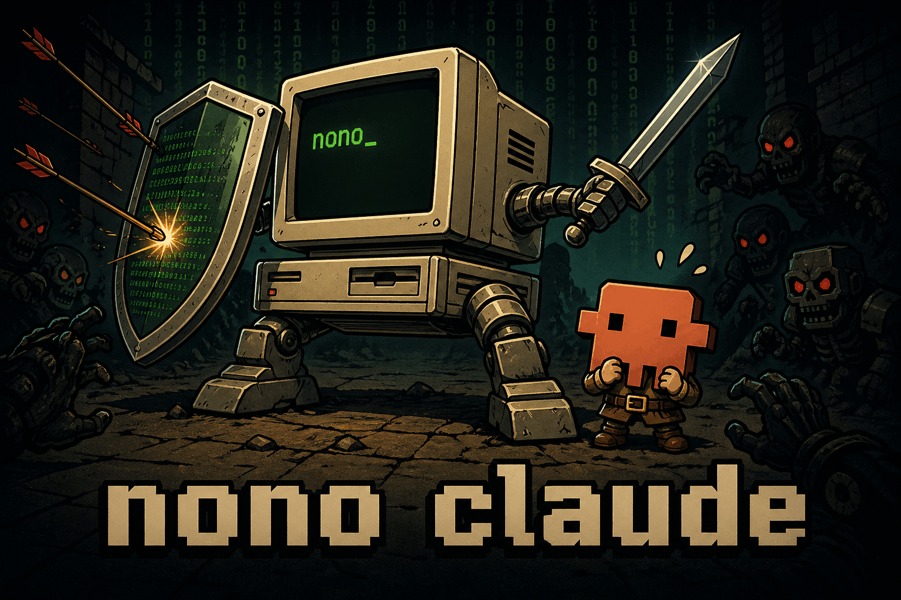

<p align="center">
  
</p>

# claude nono

`claude` is a `nono` package / plugin for Claude Code.

It installs a Claude plugin, hook definitions, shell helpers, and a packaged skill that make Claude Code behave correctly when it is running inside a `nono` security sandbox.

## Quick start

```bash
# Install the pack
nono pull nolabs-ai/claude

# Run Claude Code inside the sandbox
nono run --profile nolabs-ai/claude -- claude
```

## What It Does

This pack is focused on one problem: when Claude hits a sandbox boundary, it should stop guessing and explain the real fix.

The pack provides:

- a Claude plugin manifest in `.claude-plugin/plugin.json`
- hook registrations in `hooks/hooks.json`
- a `PostToolUseFailure` hook that explains hard sandbox denials
- a `PostToolUse` Bash hook that detects permission failures in shell output
- a `nono-sandbox` skill that teaches the correct diagnostic flow

## Behavior

When Claude is running inside a `nono` sandbox and a tool call fails due to blocked filesystem or network access, the installed hooks:

- detect that the session is sandboxed via `NONO_CAP_FILE`
- read the current capability set
- inject sandbox-specific context back into Claude
- instruct Claude to run `nono why` before advising the user
- steer Claude toward the two valid remediations
- recommend restarting with additional `--allow` access when needed
- recommend creating a reusable `nono` profile for repeated access

The profile also sets `LC_MESSAGES=C` so denial diagnostics stay in English and
can be matched reliably on localized systems. It does not filter inherited
environment variables or change other locale categories. An explicitly set
`LC_ALL` still takes precedence, following standard locale rules.

This prevents common bad guidance such as retrying the same action, suggesting `chmod`, or treating the failure like a normal OS permissions issue.

## Sandbox Preparation

The profile also has to make Claude Code's own runtime paths usable inside the sandbox.
Landlock and Seatbelt can only attach a rule to a path that already exists, and nono
silently drops a standalone grant for a missing one. Because capabilities are resolved
before `session_hooks.before` runs, creating `/tmp/claude-$UID` in that hook would only
make the grant available to the *next* session.

The profile sets `CLAUDE_CODE_TMPDIR` to `~/.claude/tmp`, where Claude creates its
per-user `claude-$UID` tree, and points tool-facing `TMPDIR` at that exact tree. Nono
prepares and grants `~/.claude` before it resolves capabilities, so Claude and its tools
can create and read temp files on the first launch even when `/tmp/claude-$UID` did not
exist before the sandbox started. Keeping temp files under this private, already-granted
directory also avoids broad read access to shared `/tmp`. `bin/ensure-dirs.sh` prepares
the private temp tree and maintains the other Claude runtime directories, including the
Linux cross-session socket directory.

## Included Artifacts

The pack currently ships:

- `.claude-plugin/plugin.json`
- `skills/nono-sandbox/SKILL.md`
- `hooks/hooks.json`
- `bin/nono-hook.sh`
- `bin/nono-hook-bash.sh`
- `bin/ensure-dirs.sh`

These artifacts are declared in [`package.json`](./package.json).

## Package Metadata

- Name: `claude`
- Pack type: `agent`
- Platforms: `macos`, `linux`
- License: `Apache-2.0`
