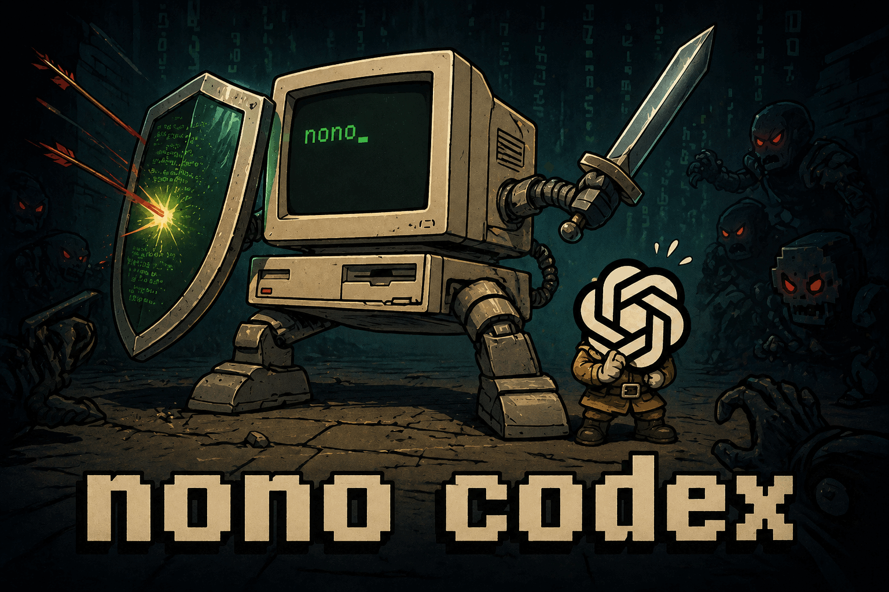

<p align="center">
  
</p>

# nono codex

Sandbox profile and Codex plugin for running [OpenAI Codex CLI](https://developers.openai.com/codex) inside a [nono](https://nono.sh) security sandbox.

Run Codex with nono as the sandbox and Codex's approval flow retained:

```bash
nono run --profile nolabs-ai/codex -- codex --no-daemon --sandbox danger-full-access --ask-for-approval on-request
```

If the pack isn't already installed, nono will prompt to pull it.

## Codex sandbox isolation

Recent Codex versions normally connect the TUI to a shared background app-server. The app-server owns the agent harness and tool execution, and it can outlive the TUI that started it. Sandboxing only the TUI is therefore not sufficient: a sandboxed TUI could attach to a daemon started outside nono and have its tools execute outside the active nono sandbox. A daemon started inside nono can instead retain that first session's grants after the session exits.

For a fully contained interactive session, use nono's standard Codex flags together with `--no-daemon`:

```bash
nono run --profile nolabs-ai/codex -- codex --no-daemon --sandbox danger-full-access --ask-for-approval on-request
```

- `--no-daemon` makes the TUI use its embedded app-server instead of probing, starting, or attaching to the shared daemon. The embedded server and its tools remain inside the same nono sandbox as the TUI.
- `--sandbox danger-full-access` disables Codex's overlapping built-in sandbox. nono remains the OS-enforced filesystem and network boundary on both macOS and Linux.
- `--ask-for-approval on-request` retains Codex's approval flow for actions it decides should require confirmation.

The pack deliberately does not append these flags automatically because a nono profile cannot rewrite the launched command, and `--no-daemon` is incompatible with Codex commands that require the shared server, including `codex agents` and `codex queue`.

If you omit `--no-daemon`, Codex may connect to an already-running daemon outside the sandbox. In that configuration, the profile constrains the TUI process but cannot guarantee that model tools or network requests executed by the external daemon are contained.

### Platform-specific daemon protection

- **macOS:** the profile denies `~/.codex/app-server-control` and `/private/tmp/codex-daemon-*`. This is fail-closed protection against accidentally attaching to a daemon outside nono. Codex does not automatically fall back when its required daemon connection is blocked; restart it with `--no-daemon`.
- **Linux:** the profile cannot use the same nested path deny. Landlock is allow-list based and cannot subtract the daemon socket from the broader read-write `~/.codex` grant that Codex needs for its state. nono can instead enable default-deny mediation for every pathname Unix socket, but doing so here would also block unrelated sockets used by tools inside Codex. Use `--no-daemon`; it bypasses daemon discovery even when a daemon is already running.

Do not stop a shared daemon merely to start a sandboxed session. `--no-daemon` bypasses it without disrupting other Codex clients.

## What's in the pack

- **`policy.json`** — sandbox profile (loaded as `--profile nolabs-ai/codex`). Grants `~/.codex`, `~/.agents`, `~/.config/nono/{profiles,packages}` (read-only), the OpenAI auth origin, and runtime groups for Node, Rust, Python, Nix.
- **`.codex-plugin/plugin.json`** — Codex plugin manifest, exposes the `nono-sandbox` skill.
- **`bin/nono-hook.sh`** — compatibility no-op for older installs that still have the previous `PostToolUse` hook entry.
- **`bin/nono-hook-session.sh`** — compatibility no-op for older installs that still have the previous `SessionStart` hook entry.
- **`skills/nono-sandbox/SKILL.md`** — skill describing how to diagnose and resolve sandbox denials.

## Activating sandbox guidance

`nono pull nolabs-ai/codex` writes the marketplace registration and the cache symlink, and merges a marked `nono` block into `~/.codex/config.toml` (`developer_instructions`, plus the marketplace/plugin entries) so Codex knows how to diagnose and remediate nono sandbox denials. The merge is scoped to a marked block, so your other `config.toml` settings are left untouched.

## Hook noise

Codex currently renders hook output in the TUI, even for hook entries marked `"silent": true`. This pack avoids that channel: fresh installs do not register Codex hooks. Sandbox-denial handling is provided by the `nono-sandbox` skill instead.

## Source

`https://github.com/nolabs-ai/nono-packs/tree/main/codex`

Published via Sigstore-signed releases triggered by tags matching `codex-v*`.
